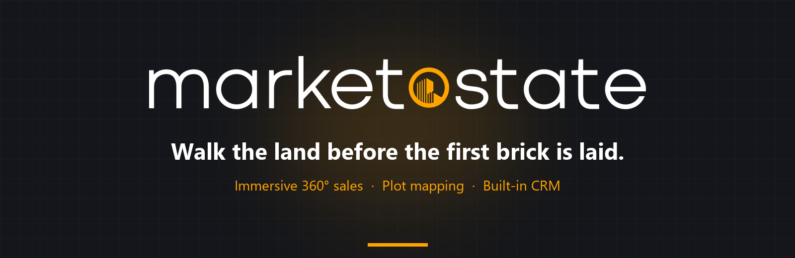

<div align="center">



<br />

**Immersive 360° sales platform for plotted developments, townships and pre-launch towers.**

Draw plots on drone panoramas, share the whole project in one branded link, and turn every walkthrough into a CRM lead.

<br />

[](https://realestate-nu-bice.vercel.app)


[Features](#-features) · [Tech Stack](#-tech-stack) · [Getting Started](#-getting-started) · [Project Structure](#-project-structure) · [Deployment](#-deployment)

</div>

---

## ✨ Overview

**MarketoState** turns raw land, plotted townships and unbuilt towers into immersive 360° worlds. Every plot is drawn, priced and tracked live on the drone view itself, and the entire project can be shared through a single branded link that a buyer can walk through from anywhere on Earth.

Behind the buyer experience sits a full sales back-office: a CRM for leads, contacts, deals and quotes, broker and client-team management, and fine-grained access control per project.

## 🚀 Features

### Immersive sales experiences
| | |
|---|---|
| 🌐 **360° Panorama Plot Marker** | Draw, label and colour-code plots directly on drone panoramas with live availability status. |
| 🗺️ **Earth View** | Place the project in its real-world geographic context. |
| 🛣️ **Sales Route Maps** | Interactive maps with custom pointers, hover routes and distance callouts to nearby landmarks. |
| 🌗 **Day / Night View** | Toggle between day and night renders or videos of the same scene. |
| 🏢 **Building Maps & Plans** | Tower-level maps linked to floor plans and unit details. |
| 📐 **Floor Plans & Project Plans** | Browsable layouts linked back to the master panorama. |
| 🏠 **Flat 360°** | Interior virtual tours for individual units. |
| 🖼️ **Galleries** | Image and 360° media galleries per project. |
| 🔗 **Full View & Share Links** | One branded, customisable public link per project with custom endpoints. |

### Sales back-office
| | |
|---|---|
| 📇 **CRM** | Unified leads, contacts, deals and quotes with custom fields, quote templates and lead assignment. |
| 🤝 **Broker Network** | Broker invites, project-level access levels and contact-reveal controls. |
| 👥 **Clients & Teams** | Multi-organisation client workspaces with team invites and member limits. |
| 🔐 **User Access Management** | Role-based access to projects, panoramas and resources. |
| 📊 **Dashboards** | Admin, client and customer dashboards with paginated, indexed CRM views. |

## 🧰 Tech Stack

| Layer | Technology |
|---|---|
| **Backend** | Python 3.11, Flask, Flask-Compress, Gunicorn |
| **Database & Auth** | Supabase (PostgreSQL, Auth, JWT) |
| **Storage** | Supabase Storage / S3-compatible via `boto3` |
| **Frontend** | Jinja2 templates, Charm UI design system (`shared-ui/static/ui`), vanilla JS / ES modules |
| **Media** | Pillow for image processing, large video uploads for day/night scenes |
| **Hosting** | Vercel, Hostinger, Render or any WSGI host |

## 🏁 Getting Started

### Prerequisites

- Python **3.11+**
- A [Supabase](https://supabase.com) project

### 1. Clone and install

```bash
git clone https://github.com/abhrajeet17/marketo-estate.git
cd marketo-estate

python -m venv .venv
source .venv/bin/activate        # Windows: .venv\Scripts\activate
pip install -r requirements.txt
```

### 2. Configure environment

```bash
cp .env.example .env
```

| Variable | Required | Description |
|---|:---:|---|
| `SUPABASE_URL` | ✅ | Supabase project URL |
| `SUPABASE_ANON_KEY` | ✅ | Public anon key used for client login |
| `SUPABASE_SERVICE_ROLE_KEY` | ✅ | Service role key for server-side DB access (keep secret) |
| `SUPABASE_JWT_SECRET` | ✅ | Used to verify user tokens |
| `FLASK_SECRET_KEY` | ➖ | Session signing key |
| `MAX_UPLOAD_BYTES` / `MAX_DAYNIGHT_VIDEO_BYTES` | ➖ | Upload size limits |
| `GUNICORN_TIMEOUT` | ➖ | Worker timeout for slow uploads |

### 3. Set up the database

Run [`app-backend/db/schema.sql`](app-backend/db/schema.sql) in the Supabase SQL editor, then apply the `app-backend/db/migration_*.sql` files.

### 4. Run

```bash
python app-backend/app.py
```

The app starts on **http://localhost:5000**.

## 📁 Project Structure

```text
├── admin-dashboard-ui/   # Builder back-office: dashboard, editors, Sales Tools, Building Plans, Full View builder, users
│   ├── templates/
│   └── static/           # js/dashboard = builder dashboard ES modules (core, views, features, builder)
├── client-ui/            # What client admins, sales agents, brokers and customers see: portal, CRM, Projects, viewers
│   ├── templates/
│   └── static/
├── shared-ui/            # Base layout, login, portal shell, Charm UI, theme, vendor libraries
│   ├── templates/
│   └── static/
├── app-backend/
│   ├── app/
│   │   ├── controllers/  # Route registration and feature controllers (CRM, UAM, gallery, maps…)
│   │   ├── services/     # Business logic and Supabase / storage access
│   │   ├── core/         # Auth, database client, concurrency helpers
│   │   ├── paths.py      # Repository layout: where templates, static files and uploads live
│   │   └── config.py
│   ├── db/               # Schema and incremental SQL migrations
│   ├── scripts/          # Build and maintenance utilities
│   ├── app.py            # Entry point
│   └── gunicorn.conf.py  # Production server config
└── deploy/               # Hosting-specific deployment configs

Templates and static files from the three UI folders are merged at runtime, so page names and
`/static/...` URLs do not depend on which folder a file lives in. Code used by both audiences
belongs in `shared-ui`.
```

## ☁️ Deployment

Production runs with Gunicorn:

```bash
gunicorn --pythonpath app-backend -c app-backend/gunicorn.conf.py app:app
```

See [DEPLOYMENT.md](DEPLOYMENT.md) for step-by-step guides for each hosting provider, and [SCALING_CODING_PRACTICES.md](SCALING_CODING_PRACTICES.md) for performance conventions.

## 🤝 Contributing

1. Create a feature branch from `master`.
2. Follow the conventions in [`docs/frontend_coding_practices_ui_guidelines.md`](docs/frontend_coding_practices_ui_guidelines.md).
3. Add a new `app-backend/db/migration_*.sql` file for any schema change.
4. Open a pull request with a clear description and screenshots for UI changes.

---

<div align="center">


**MarketoState** — Walk the land before the first brick is laid.

© MarketoState. All rights reserved.

</div>
